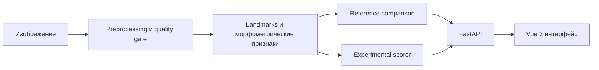

# FaceAnalyserPSL

Локальный проект компьютерного зрения для измеримого анализа геометрии лица. Он извлекает landmarks и морфометрические признаки, сравнивает их с reference-группами и показывает результаты в веб-интерфейсе.

**Это исследовательский прототип, а не медицинский инструмент.** Морфометрический отчёт и экспериментальный субъективный scorer — разные части системы: scorer не является объективной оценкой внешности и зависит от обучающей выборки.

## Возможности

- 2D pipeline: обнаружение лица, оценка качества кадра, landmarks, выравнивание, измерения, пропорции, симметрия и углы.
- Сравнение признаков с reference-группами с указанием доступности и качества данных.
- Локальный FastAPI API и Vue 3 интерфейс с наложением измерений на изображение.
- Необязательные расширения: плотные MediaPipe landmarks, template-based 3D признаки, robustness и subgroup coverage analysis.
- Изолированный experimental scorer, обучаемый на размеченном наборе; его score и объяснения помечены как субъективные и экспериментальные.

## Как устроен проект



Основные части:

| Путь | Назначение |
| --- | --- |
| `src/face_aesthetics/` | Пакет обработки, признаков, моделей и API |
| `configs/` | Настройки этапов pipeline |
| `scripts/` | Команды подготовки данных, обучения и inference |
| `apps/web/` | Vue 3 + Vite интерфейс |
| `tests/` | Проверки модулей и pipeline |
| `docs/technical-guide.md` | Подробный runbook и описание артефактов |

## Быстрый старт

Нужны Python, Node.js с npm и локальные InsightFace ONNX-модели. Сырые наборы изображений для single-image inference не нужны. Веса InsightFace не хранятся в репозитории; поместите `det_10g.onnx` и `2d106det.onnx` в `data/interim/insightface_models/models/buffalo_l/`.

Установите Python-зависимости и запустите API:

```bash
python -m venv .venv
source .venv/bin/activate  # Windows: .venv\Scripts\activate
python -m pip install --upgrade pip
python -m pip install -r requirements.txt
python scripts/run_api.py
```

В другом терминале запустите веб-интерфейс:

```bash
cd apps/web
npm ci
npm run dev
```

Откройте `http://127.0.0.1:5173`. Vite проксирует запросы к API на `http://127.0.0.1:8000`; API предоставляет документацию по адресу `http://127.0.0.1:8000/docs`.

В reference-aware inference используются артефакты из `models/reference/`. Для экспериментального scorer также закоммичены собранные модели в `models/scoring/`. Чтобы обучить модели на собственных данных, см. техническое руководство.

## Данные и ограничения

- Сырые изображения, пользовательские датасеты и промежуточные результаты не включаются в Git. Подготовьте собственные данные и проверьте условия их использования перед запуском обучающих скриптов.
- Репозиторий содержит производные reference-данные и сериализованные модели для локального inference; они не включают исходные наборы изображений.
- Качество измерений зависит от ракурса, разрешения, окклюзий и используемого landmark backend. Quality gate может пометить вход как непригодный.
- Reference-сравнение описывает статистическое положение относительно доступной группы; это не медицинская норма и не универсальный стандарт.
- Learned score отражает закономерности конкретного размеченного набора, может быть смещён его размером и балансом и не должен трактоваться как объективная истина.
- 3D ветка использует детерминированное template-based lifting по 2D-точкам, а не learned 3D reconstruction.
- API и интерфейс рассчитаны на локальный исследовательский запуск; перед сетевым или публичным развёртыванием требуется отдельная оценка безопасности и приватности.

## Техническая документация

В [техническом руководстве](docs/technical-guide.md) описаны подготовка manifest, preprocessing и feature extraction, reference model, single-image inference, API, web-приложение, scorer и evaluation-скрипты.

## Лицензия

Лицензия в репозитории пока не указана. Перед повторным использованием кода или артефактов уточните условия у автора и проверьте лицензии исходных данных и моделей.
